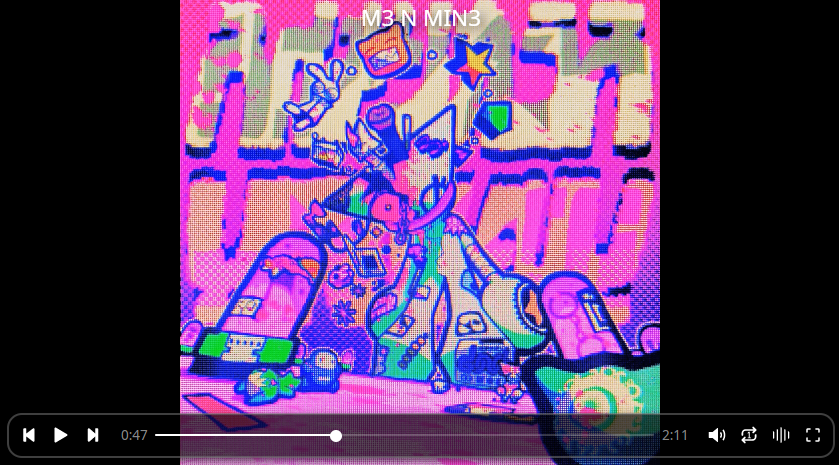
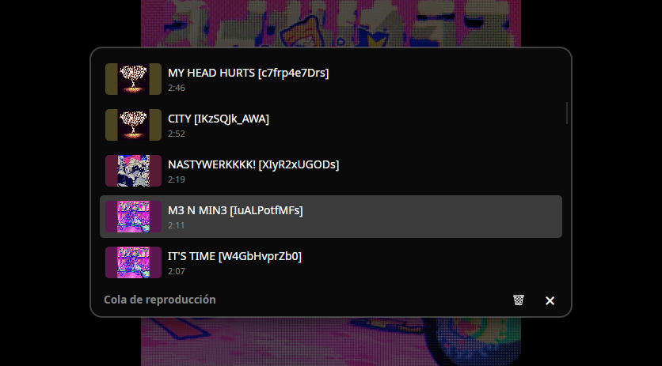

# MediaPlayer

[](https://dotnet.microsoft.com/)

[](https://github.com/1R1an1/MediaPlayer/commits/master/)
[](https://github.com/1R1an1/MediaPlayer)

**English** | [Español](README.es.md)

Native video player for Linux, built with Avalonia UI and libmpv.
Dark-themed controls over the player, desktop integration via MPRIS2 (GNOME, KDE, etc.), and mpv-style keyboard shortcuts.

---

## Screenshots

### Player



### Playlist



---

## Supported formats

- Video: `.mp4` `.mkv` `.webm` `.avi` `.mov` `.flv` `.wmv` `.mpg` `.mpeg` `.m4v` `.ts`
- Audio: `.mp3` `.flac`

---

## Requirements

| Requirement      | Detail                            |
| ---------------- | --------------------------------- |
| .NET SDK         | **10.0+**                         |
| Operating system | Linux                             |
| libmpv           | `libmpv2`                         |
| ffmpeg / ffprobe | For cover extraction and duration |

---

## Installation

```bash
curl -fsSL https://raw.githubusercontent.com/1R1an1/MediaPlayer/master/setup | bash
```

Usage:

```bash
mp                              # Opens the GUI with no files
mp video.mkv ~/folder           # Opens the GUI with one or more files/folders
mp --nogui video.mkv            # Forces the basic TUI instead of the GUI
mp --tui video.mkv              # Uses the full TUI instead of the GUI
```

The basic TUI is automatically activated if no `DISPLAY` is available (SSH sessions, headless terminals).

<details><summary>Manual installation</summary>

Since the repository includes the [SharpUtils](https://github.com/1R1an1/SharpUtils) and [TermFlow.Net](https://github.com/1R1an1/TermFlow.Net) submodules, they need to be initialized.

Clone with `--recursive`:

```bash
git clone --recursive https://github.com/1R1an1/MediaPlayer.git
cd MediaPlayer
```

Or, if already cloned without `--recursive`, initialize them:

```bash
git clone https://github.com/1R1an1/MediaPlayer.git
cd MediaPlayer
git submodule update --init --recursive
```

Build and install:

```bash
dotnet publish -c Release -r linux-x64 --self-contained true -p:PublishSingleFile=true
sudo ln -sf $(realpath ./bin/Release/net10.0/linux-x64/publish/MediaPlayer) /usr/local/bin/mp
```

</details>

---

## Video and music download

MediaPlayer uses the thumbnails embedded in files to display the cover art in the playlist and in MPRIS. For audio (`.mp3` and `.flac`) the thumbnail works universally, but for video (`.mkv`) it requires a specific format. The [`yt.sh`](https://github.com/1R1an1/MediaPlayer/blob/master/yt.sh) script uses `yt-dlp` with the correct options so that thumbnails and metadata are embedded in the app's compatible format.

Usage of the [`yt.sh`](https://github.com/1R1an1/MediaPlayer/blob/master/yt.sh) script:

```bash
./yt.sh video <URL>              # Downloads video in .mkv with embedded thumbnail and metadata
./yt.sh music <mp3|flac> <URL>   # Downloads audio only with embedded thumbnail and metadata
./yt.sh musicC <mp3|flac> <URL>  # Same as music, but crops the thumbnail to a square
./yt.sh crop                     # Crops to a square the thumbnails of all .flac and .mp3 files in the current folder
```

Requires `yt-dlp`, `ffmpeg`, and `python-mutagen` to be installed.

---

## Keyboard shortcuts

| Action            | Key                | Mode     |
| ----------------- | ------------------ | -------- |
| Play / Pause      | `Space`, `K`       | GUI, TUI |
| Next              | `N`                | GUI, TUI |
| Previous          | `B`                | GUI, TUI |
| Rewind 5s         | `←`                | GUI, TUI |
| Forward 5s        | `→`                | GUI, TUI |
| Rewind 30s        | `Shift + ←`        | GUI      |
| Forward 30s       | `Shift + →`        | GUI      |
| Rewind 60s        | `Ctrl + ←`         | GUI      |
| Forward 60s       | `Ctrl + →`         | GUI      |
| Forward 1 frame   | `.`                | GUI      |
| Rewind 1 frame    | `,`                | GUI      |
| Volume +5%        | `↑`, `+`, `0`      | GUI, TUI |
| Volume -5%        | `↓`, `-`, `9`      | GUI, TUI |
| Mute              | `M`                | GUI, TUI |
| Change loop mode  | `L`                | GUI, TUI |
| Toggle shuffle    | `S`                | GUI, TUI |
| Next audio track  | `J`                | GUI      |
| Fullscreen        | `F`                | GUI      |
| Exit fullscreen   | `Esc`              | GUI      |
| Show / hide queue | `C`                | GUI      |
| Open files        | `Ctrl + O`         | GUI      |
| Open folder       | `Ctrl + Shift + O` | GUI      |
| Exit              | `Q`                | GUI, TUI |

---

## Issues

If you found a bug or have an idea to improve the app, you can open an [Issue](https://github.com/1R1an1/MediaPlayer/issues) in the repository.

---

## License

This project is licensed under the **Mozilla Public License 2.0 (MPL-2.0)**.

See [LICENSE](https://github.com/1R1an1/MediaPlayer/blob/master/LICENSE) for the full text.
